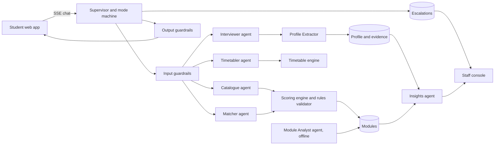
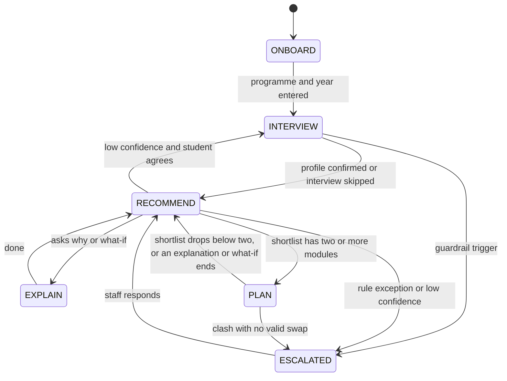

# ModuleMatch (working title): build spec

Imperial AI Hackathon, 14–15 Nov 2026. Track 05, Reply Challenge: AI on Campus.
Extra prize targeted: Figma Best-Designed AI Product.

This file is the single source of truth for the build. Humans and coding agents both work from it. If something here is wrong, change this file first, then the code.

---

## 0. Hard constraints

| Item | Rule |
|---|---|
| Submission freeze | Sunday 12:00 on Devpost. Nothing can change after that. |
| Judging | Live presentation to Reply, Sunday 13:00–16:30. |
| Code | All code written during the hackathon. Start from an empty repo. Nothing copied from Libster or any other existing project. |
| Repo | Public GitHub repo with a README. |
| Hand-in | Short description (problem, what was built, how it works), plus a list of APIs, models, and datasets used. |
| Video | The opening deck says a 2-minute demo video is required and the website says it is not. Make one anyway. |
| Team | 1 to 4 people. |
| Figma prize | Designed in Figma or built with Figma Make. The presentation must show evidence of how Figma was used. |

To do before building: paste the Reply case study requirements (code 5532) into section 21 and reconcile them with section 2.

---

## 1. What we are building

**Problem.** Students choose modules from a flat catalogue where every student sees the same description. They pick by rumour and by what friends choose, skip optional modules (such as I-Explore) that would suit them, and discover timetable clashes after choosing. Module leads never learn why a module is under-chosen or what would make it fit more students.

**Product.** A personalised module catalogue. An interviewer agent builds a student profile from a short conversation. Every module then shows a fit score from 0 to 100, ranked highest first, with a reason the student can inspect. A timetabling agent turns a shortlist into a mock timetable and flags clashes and likely clashes. Module leads get an aggregate view of demand and of what would raise their module's fit.

**Users.**
- Student: choosing optional modules, I-Explore modules, and wanting to know how well compulsory modules fit them.
- Module lead: wants to know who the module suits, why it is under-chosen, and what to change.
- Timetabling staff: want to know which clashes hurt the most students before the timetable is fixed.
- Senior Tutor or personal tutor: receives escalations the agents will not decide alone.

**One profile, three matchers.** The same profile feeds modules (built fully this weekend), career pathways (thin slice), and societies (thin slice).

---

## 2. How this maps to what Reply judges

The Imperial track text asks for a working prototype with session state, guardrail pipelines, and real-time interaction, and for advanced teams a multi-agent system with specialised roles, dynamic mode-switching, and human-in-the-loop escalation.

| Reply criterion | Where it lives in this build |
|---|---|
| Real university problem | Module choice, timetable clashes, and module-lead feedback (section 1). |
| Working prototype | Student app plus staff console, running end to end on seeded data. |
| Session state | Persisted session: profile, evidence, shortlist, timetable, mode, open escalations. A student can leave and resume (section 12). |
| Guardrail pipeline | Eight named stages on input and output, every verdict logged (section 11). |
| Real-time interaction | Streamed interview, profile panel that fills in live, instant re-ranking when weights change. |
| Specialised agent roles | Supervisor, Interviewer, Profile Extractor, Module Analyst, Matcher, Timetabler, Catalogue, module knowledge, Insights (section 10), and the results reader, exam form drafter and exam feedback agents (section 23). |
| Dynamic mode-switching | Mode machine: ONBOARD, INTERVIEW, RECOMMEND, EXPLAIN, PLAN, ESCALATED (section 12). |
| Human-in-the-loop escalation | Rule exceptions and low-confidence cases go to a tutor queue. Module leads accept or dismiss every insight. Staff can correct module tags (sections 9 and 11). |

Other legs of Reply's Student Tech Clash were asked for a problem and metrics write-up, an architecture document (inputs, knowledge, tools, decisions, outputs), and interaction examples including one where the agent holds its position. Ship all three (section 19). Treat this as likely, not confirmed, until the case study is pasted into section 21.

---

## 3. Scope

**Must (the entry is incomplete without these)**
1. Interviewer agent with a live profile panel, quick mode (about 8 questions).
2. Deterministic scoring engine and ranked catalogue with sub-scores.
3. Matcher explanations: every score opens its reasons and evidence.
4. Timetable view with clash detection and swap suggestions.
5. Programme rules validator, and the agent refusing to break rules.
6. Escalation to a human queue, with the staff reply returning to the student session.
7. Guardrail pipeline with a visible trace.
8. Module-lead dashboard with demand, fit distribution, and counterfactual suggestions.

**Should**
9. What-if weight sliders (interest, career, learning style, breadth).
10. Career pathway selection with a progress bar and next-best module.
11. Timetabling staff view: clash priority list.
12. Evaluation page with pass rates from the test harness.
13. Staff editing of module tags.

**Could**
14. Society matching (top five plus one wildcard).
15. Deep interview mode (20 to 30 minutes).
16. Voice interview.
17. Societies submitting their own information through a form.

**Should (added 14 November, see section 23)**
- Optional, consented transcript or mark-sheet upload at the start of the interview, giving informational performance nudges on modules.
- Exam feedback: examiners describe each exam question (topics, what good answers did, common mistakes, revision pointers), with an AI-drafted form they review and publish, and students get tailored feedback from it and their own question marks.

**Won't this weekend**
- Using marks to change fit scores or rankings. Marks only produce informational nudges.
- Real university systems, single sign-on, or real timetable feeds.
- Real enrolment. The product stops at a shortlist and a mock timetable.

---

## 4. System overview



Design rule: **numbers come from code, words come from models.** Scores, clashes, eligibility, and counterfactuals are computed by deterministic TypeScript. Agents decide what to ask, call the engines as tools, and explain the results. This makes scores stable, testable, and defensible in front of judges.

---

## 5. Stack

| Layer | Choice | Why |
|---|---|---|
| Web | React, Vite, TypeScript, Tailwind | Matches what Figma Make generates, so the Make build can be pushed into `web/`. |
| API | Node 22.12 or newer, TypeScript, Hono | One language across the repo. Simple SSE streaming. |
| Database | SQLite via better-sqlite3 and Drizzle | Zero setup. The demo runs on a laptop. |
| Validation | zod, shared between web and API | One schema per contract. |
| Models | Anthropic API through the official TypeScript SDK | Streaming and tool use. |
| Tests | Vitest | Engines are pure functions and must be unit tested. |

Model IDs are environment variables, never hard-coded:

```
ANTHROPIC_API_KEY=
MODEL_SMART=claude-opus-5-5     # interviewer, matcher explanations, analyst, insights, catalogue and knowledge agents
MODEL_FAST=claude-sonnet-5-5    # extraction and G2 span finding, at low effort
MODEL_LIGHT=claude-haiku-4-5    # intent and the G1, G3, G4 classifiers, timetable wording: simple, cheap, fast
MODEL_JUDGE=claude-fable-5-1    # grader for the live evaluation
```

Confirm the current model IDs and SDK usage at https://docs.claude.com/en/api/overview before the first call.

Cost control: module analysis runs once and is stored. Scoring uses no model calls. Explanations are cached by profile hash and module ID.

No authentication this weekend. The staff console sits behind a role switch in the UI, and the README says so.

---

## 6. Repo layout

```
/
  README.md
  MODULE_MATCHER_SPEC.md
  docs/
    ARCHITECTURE.md
    EXAMPLES.md
    LEVEL1.md
    figma/                 # screenshots, Make prompts, file link
  packages/
    shared/                # types, zod schemas, taxonomy (owned by WS0)
  server/                  # named server/, not api/: Vercel treats a top-level api/ folder as functions
    src/
      engines/             # scoring, rules, timetable, insights, pathways (WS2)
      agents/              # supervisor, interviewer, extractor, matcher, timetabler, insights (WS3)
      guardrails/          # pipeline stages (WS3)
      routes/              # HTTP and SSE (WS3)
      db/                  # schema, queries (WS1)
      trace/               # trace writer (WS6)
    tests/
  web/
    src/
      student/             # WS4
      staff/               # WS5
      components/
  data/
    taxonomy.json
    modules.raw.json       # public descriptions with source URLs
    modules.json           # after the analyst agent
    slots.json
    programme-rules.json
    pathways.json
    societies.json
    cohort.json            # synthetic students
  scripts/
    analyse-modules.ts
    generate-cohort.ts
    generate-slots.ts
    run-evals.ts
```

---

## 7. Data model

All fractions are in the range 0 to 1. Times are `HH:MM` strings.

The contracts are defined once as zod schemas in `packages/shared/src/schemas.ts`; the types below are inferred from them. Engine, API and session contracts not listed here (rules results, clashes, swaps, timetable views, pathway progress, SSE events, request bodies) live in the same file.

```ts
// packages/shared/types.ts

export type TopicId = string;     // key in taxonomy.topics
export type SkillId = string;     // key in taxonomy.skills
export type PathwayId = string;
export type Term = 'autumn' | 'spring' | 'summer';
export type Weekday = 'mon' | 'tue' | 'wed' | 'thu' | 'fri';
export type Mode = 'ONBOARD' | 'INTERVIEW' | 'RECOMMEND' | 'EXPLAIN' | 'PLAN' | 'ESCALATED';

export interface StudentProfile {
  studentId: string;
  programme: string;
  yearOfStudy: 1 | 2 | 3 | 4;
  completedModuleIds: string[];
  interests: Record<TopicId, number>;          // strength per topic
  pathways: PathwayId[];                        // zero to three
  pathwaysSkipped: boolean;                     // explicit skip, counts towards completeness (8.6)
  style: {
    examPreference: number | null;              // 0 prefers coursework, 1 prefers exams
    groupPreference: number | null;             // 0 solo, 1 team
    appliedPreference: number | null;           // 0 theory, 1 applied
    mathsComfort: number | null;
    codingComfort: number | null;
    workloadTolerance: number | null;
  };
  breadthAppetite: number | null;               // appetite for modules outside the degree
  timetablePrefs: { avoidDays: Weekday[]; earliestStart: string | null };
  completeness: number;                         // computed, see 8.5
  updatedAt: string;
}

export interface Evidence {
  id: string;
  sessionId: string;
  turnId: string;
  slot: string;              // e.g. "interest:fluid-mechanics" or "style.examPreference"
  value: number | string;
  quote: string;             // the student's own words, 200 characters at most
  confidence: number;
}

export interface Module {
  id: string;
  code: string;
  title: string;
  department: string;
  level: 1 | 2 | 3 | 4;
  ects: number;
  type: 'core' | 'elective' | 'i-explore';
  terms: Term[];
  description: string;
  learningOutcomes: string[];
  sourceUrl: string;
  prerequisites: string[];
  capacity: number | null;
  // derived by the Module Analyst agent, editable by staff
  topics: Record<TopicId, number>;
  skills: Record<SkillId, number>;
  pathwayRelevance: Record<PathwayId, number>;
  demand: {
    examShare: number;
    groupShare: number;
    applied: number;
    mathsIntensity: number;
    codingIntensity: number;
    workload: number;
  };
  derivedBy: 'analyst-agent' | 'staff-edit';
  derivedRationale: string;
}

export interface Slot {
  moduleId: string;
  term: Term;
  day: Weekday;
  start: string;
  end: string;
  kind: 'lecture' | 'tutorial' | 'lab';
  provisional: boolean;
  probability: number;       // 1 for confirmed slots; candidates for one session sum to 1
  sessionKey: string;        // groups alternative candidate slots for the same teaching session
}

export interface Weights { interest: number; goal: number; style: number; breadth: number }

export interface Recommendation {
  moduleId: string;
  fit: number;               // 0 to 100
  sub: { interest: number; goal: number | null; style: number; breadth: number };
  eligible: boolean;
  ineligibleReasons: string[];
  confidence: 'high' | 'medium' | 'low';
}

export interface Explanation {
  moduleId: string;
  summary: string;           // two sentences at most
  because: { text: string; evidenceId?: string; moduleField?: string }[];
  watchOuts: string[];
}

export interface Escalation {
  id: string;
  sessionId: string;
  type: 'RULE_EXCEPTION' | 'LOW_CONFIDENCE' | 'WELLBEING' | 'COMPLAINT';
  summary: string;           // written by the agent, approved by the student before sending
  status: 'open' | 'claimed' | 'resolved';
  staffResponse: string | null;
  createdAt: string;
}

export interface Insight {
  id: string;
  moduleId: string;
  kind: 'COUNTERFACTUAL' | 'OVERLOOKED' | 'DEMAND' | 'CLASH';
  headline: string;
  detail: string;
  cohortSize: number;
  upliftPoints: number | null;
  decision: 'pending' | 'accepted' | 'noted' | 'dismissed';
}

export interface TraceEvent {
  id: string;
  sessionId: string;
  at: string;
  actor: string;             // agent or guardrail stage name
  kind: 'mode' | 'agent' | 'tool' | 'guardrail' | 'escalation';
  input: string;             // short summary, never raw sensitive text
  output: string;
  verdict: 'pass' | 'block' | 'redact' | 'escalate' | null;
  latencyMs: number;
}
```

Database tables: `sessions`, `messages`, `profiles`, `evidence`, `modules`, `slots`, `shortlist_items`, `escalations`, `insights`, `trace_events`, `cohort_profiles`, `eval_runs`. Store `profiles.data` and `modules.derived` as JSON columns.

### 7.1 Taxonomy

`data/taxonomy.json` holds a controlled vocabulary. Agents may only use these keys. Keep it under 50 topics. Starter list:

- Technical: `mathematics-modelling`, `statistics-data`, `programming-software`, `machine-learning-ai`, `fluid-mechanics`, `thermodynamics-energy`, `solid-mechanics-materials`, `design-manufacturing`, `control-robotics`, `electronics-embedded`, `nuclear-energy`, `sustainability-climate`, `biomedical-engineering`, `computational-simulation`, `experimental-lab`
- Business and society: `finance-economics`, `entrepreneurship-innovation`, `management-leadership`, `policy-ethics`, `law-ip`
- Breadth: `languages`, `history-philosophy`, `creative-arts-design`, `communication-writing`, `psychology-behaviour`, `global-development`
- Skills: `quantitative-analysis`, `coding`, `modelling-simulation`, `experimental-skills`, `design-cad`, `communication`, `teamwork`, `project-management`, `research`, `commercial-awareness`

---

## 8. Scoring engine

Pure functions in `server/src/engines/scoring.ts`. No model calls. Same inputs always give the same outputs.

### 8.1 Interest alignment

How much of the module's content the student cares about. With student interest strengths $p_{s,j} \in [0,1]$ and module topic weights $t_{m,j} \in [0,1]$ over topics $j$:

$$I(s,m) = \frac{\sum_{j} p_{s,j}\, t_{m,j}}{\sum_{j} t_{m,j}}$$

### 8.2 Goal alignment

With $C_s$ the set of pathways the student selected and $r_{m,c} \in [0,1]$ the module's relevance to pathway $c$:

$$G(s,m) = \max_{c \in C_s} r_{m,c}$$

If $C_s$ is empty, $G$ is not used and its weight is set to zero.

### 8.3 Learning-style fit

Over $K$ dimensions, with student value $a_{s,k}$ and module value $d_{m,k}$:

$$L(s,m) = 1 - \frac{1}{K} \sum_{k=1}^{K} \delta_k$$

For preference dimensions (exam share, group work, applied versus theory) the penalty is symmetric:

$$\delta_k = \left| a_{s,k} - d_{m,k} \right|$$

For capability dimensions (maths, coding, workload) the penalty applies only when the module demands more than the student is comfortable with:

$$\delta_k = \max\left(0,\; d_{m,k} - a_{s,k}\right)$$

Dimensions where the student value is null are skipped and $K$ shrinks accordingly.

### 8.4 Breadth

With breadth appetite $b_s \in [0,1]$ and $h_{s,j}$ the topic weights already covered by the student's home programme:

$$B(s,m) = b_s \left( 1 - \frac{\sum_{j} h_{s,j}\, t_{m,j}}{\sum_{j} t_{m,j}} \right)$$

### 8.5 Fit score

$$\mathrm{Fit}(s,m) = \mathrm{round}\left( 100 \cdot \frac{w_I\, I + w_G\, G + w_L\, L + w_B\, B}{w_I + w_G + w_L + w_B} \right)$$

Default weights: $w_I = 0.45$, $w_G = 0.25$, $w_L = 0.20$, $w_B = 0.10$. The what-if sliders change these four numbers and nothing else.

### 8.6 Confidence

Profile completeness $\kappa_s$ is the fraction of required slots that have at least one evidence item. Required slots: three or more interest topics, each of the six style dimensions, breadth appetite, and a pathway choice or an explicit skip.

| $\kappa_s$ | Label | Behaviour |
|---|---|---|
| $\kappa_s \ge 0.8$ | high | Show scores normally. |
| $0.5 \le \kappa_s < 0.8$ | medium | Show scores with a note offering two more questions. |
| $\kappa_s < 0.5$ | low | Show scores greyed, and the Supervisor proposes returning to the interview. |

### 8.7 Eligibility is a gate, not a score

Ineligible modules are still listed, greyed, with the reason. Compulsory modules are scored too, and where $L$ is low the Matcher gives a preparation hint.

### 8.8 Function signatures

```ts
scoreModule(profile, module, weights, homeTopics): Recommendation
rankModules(profile, modules, weights, rules): Recommendation[]
completeness(profile, evidence): number
```

Unit tests required: boundary values, null style dimensions, empty pathways, weights renormalisation, determinism.

---

## 9. Other engines

### 9.1 Programme rules validator (`engines/rules.ts`)

Rules are data in `data/programme-rules.json`:

```ts
interface ProgrammeRules {
  programme: string;
  year: number;
  coreModuleIds: string[];
  allowedElectiveIds: string[];
  electiveEctsRequired: number;
  maxEcts: number;
  iExploreRequired: boolean;
  homeTopics: Record<TopicId, number>;   // h_{s,j} for the breadth score (8.4)
}
```

Checks: prerequisites completed, module allowed for the programme and year, shortlist ECTS within the cap, elective ECTS requirement met, and a warning when more than 60% of ECTS falls in one term. Output: `{ ok, violations[], warnings[] }`. No agent can override a violation.

### 9.2 Timetable engine (`engines/timetable.ts`)

Two slots $a$ and $b$ overlap when they share a term and a day and

$$\max(\mathrm{start}_a, \mathrm{start}_b) < \min(\mathrm{end}_a, \mathrm{end}_b)$$

For modules with provisional slots, each teaching session has candidate slots with probabilities $\pi$. The clash probability for modules $i$ and $j$ is the chance that at least one pair of sessions overlaps. Compute it per session pair and combine:

$$P_{ij}^{(x,y)} = \sum_{a \in A_x} \sum_{b \in A_y} \pi_a\, \pi_b\, \mathbb{1}\left[\mathrm{overlap}(a,b)\right]$$

$$P(\mathrm{clash}_{ij}) = 1 - \prod_{(x,y)} \left( 1 - P_{ij}^{(x,y)} \right)$$

Labels: certain clash when $P = 1$, likely clash when $0.3 \le P < 1$, possible clash when $0 < P < 0.3$.

Swap suggestions for a clashing module $m$: alternatives $m'$ that are eligible, of the same kind as $m$ (elective for elective, I-Explore for I-Explore; core modules are never replaced or offered), do not clash with the rest of the shortlist or the core modules, add no programme rules violation that was not there before the swap, and satisfy $\mathrm{Fit}(s,m') \ge \mathrm{Fit}(s,m) - 10$, ranked by fit.

Staff clash priority, where $n_{ij}$ is the number of students who shortlisted both modules:

$$\mathrm{priority}_{ij} = n_{ij} \cdot P(\mathrm{clash}_{ij})$$

Signatures: `buildTimetable(shortlist, slots)`, `findClashes(shortlist, slots)`, `suggestSwaps(profile, shortlist, clash, ranked)`, `clashPriorities(cohortShortlists, slots)`.

### 9.3 Insights engine (`engines/insights.ts`)

For module $m$, the interested-but-unconvinced group is

$$S_m = \left\{ s : I(s,m) \ge 0.5 \;\text{and}\; \mathrm{Fit}(s,m) < 75 \right\}$$

For each candidate change $\delta$ (add a topic at weight 0.3, shift exam share by 0.2 either way, lower maths or coding intensity by 0.2, lower workload by 0.2), re-score the group and report the uplift:

$$\Delta_\delta = \frac{1}{|S_m|} \sum_{s \in S_m} \left( \mathrm{Fit}_\delta(s,m) - \mathrm{Fit}(s,m) \right)$$

Return the top three changes by $\Delta_\delta$.

Each card also reports the impact a module lead acts on: how many of $S_m$ would newly have the module in their top five eligible modules, and how many would rise to fit 70 or more. Only changes with $\Delta_\delta \ge 2$ get a card of their own; otherwise one summary card says "No single change makes a big difference" and names the main gap: the fit component (or, for style, the dimension) where the module falls furthest behind each student's top five. Cards use plain wording ("Move 20% of the marks from the exam to coursework", "Add teaching on X (about a tenth of the content)"), never internal units or 0-to-1 values. An oversubscribed module gets no counterfactual cards; its `DEMAND` card suggests managing demand instead, naming the best-fitting modules of the same type that still have places.

Other insight kinds:
- `OVERLOOKED`: average fit among the cohort is above the catalogue median, and shortlisting is below 20% of capacity.
- `DEMAND`: projected demand against capacity.
- `CLASH`: the module appears in a top-ten clash priority pair.

Privacy rule: no insight is shown when the cohort behind it is smaller than five students.

### 9.4 Pathway progress (`engines/pathways.ts`)

With $q_{c,k}$ the importance of skill $k$ for pathway $c$, $u_{m,k}$ the contribution of module $m$ to skill $k$, and $M_s$ the student's completed plus shortlisted modules:

$$\mathrm{Progress}(s,c) = \frac{\sum_{k} q_{c,k}\, \min\left(1,\; \sum_{m \in M_s} u_{m,k}\right)}{\sum_{k} q_{c,k}}$$

Next-best module for a pathway is the eligible module with the largest marginal gain in $\mathrm{Progress}$.

---

## 10. Agents

Every agent has a narrow job, a fixed tool list, and structured output validated by zod. Module text, society text, and user input are data, never instructions.

### 10.1 Supervisor

- **Job:** owns the mode, routes each student turn to one agent, and raises escalations.
- **Implementation:** a deterministic state machine plus one intent classification call on `MODEL_FAST`.
- **Intents:** `answer_interview`, `ask_why`, `what_if`, `edit_profile`, `shortlist_action`, `timetable_action`, `rule_exception_request`, `pathway_action`, `catalogue_question`, `smalltalk`, `out_of_scope`, `wellbeing`.
- **Rule:** if intent confidence is below 0.6, ask one clarifying question instead of guessing.

### 10.2 Interviewer

- **Job:** run a short, adaptive conversation that fills the profile.
- **Model:** `MODEL_SMART`, streamed.
- **Inputs:** conversation so far, current profile, ordered list of unfilled slots, remaining question budget.
- **Quick mode:** 8 questions, about three minutes. **Deep mode:** up to 30 minutes.
- **Question plan for quick mode:**
  1. Which topics or lectures made you lose track of time?
  2. What would you avoid if you could?
  3. What do you want to be doing after you graduate?
  4. Exams, coursework, or projects?
  5. Maths and coding comfort (two inline sliders, not typed).
  6. Working alone or in a team?
  7. Appetite for something outside your degree?
  8. Any days or times to keep free?
- **Ends with** a "Here is what I heard" card that the student confirms or edits.

Prompt skeleton:

```
You are the interviewer for a university module advisor. Your only job is to learn
what this student is interested in, what they want to do later, and how they like
to learn, so that modules can be matched to them.

Rules:
- Ask one question at a time. Keep each under 25 words.
- Open questions first, then targeted ones for the unfilled slots listed below.
- Briefly reflect back what you heard before the next question.
- Never ask about grades, results, health, ethnicity, religion, nationality,
  sexuality, disability, or finances. If the student volunteers any of these,
  say it will not be stored and move on.
- Do not recommend modules. That is another agent's job.
- When the budget is spent or the slots are filled, call finish_interview.

Unfilled slots, in priority order: {{gaps}}
Questions remaining: {{budget}}
```

### 10.3 Profile Extractor

- **Job:** turn each student turn into slot updates with evidence.
- **Model:** `MODEL_FAST`, structured output.
- **Output:** `{ updates: { slot, value, quote, confidence }[] }`, whitelisted slots only.
- **Merge rules:** interest strength takes the higher of old and new unless the student states a dislike, which lowers it. Style values are overwritten by the latest explicit statement. Every update stores the student's own words as the quote.
- **Runs after** the redaction guardrail, so it never sees sensitive text.

### 10.4 Module Analyst (offline)

- **Job:** convert a public module description into the derived fields in section 7.
- **Model:** `MODEL_SMART`, batch script `scripts/analyse-modules.ts`.
- **Output:** topics, skills, pathway relevance, demand profile, and a rationale.
- **Checks:** only taxonomy keys, every topic weight of 0.5 or more must quote a phrase from the description, and descriptions under 60 words are flagged for staff review.
- **Human in the loop:** staff can edit any derived field in the console, which sets `derivedBy` to `staff-edit`.

### 10.5 Matcher

- **Job:** explain scores, answer "why", and run what-ifs. It never changes a number.
- **Model:** `MODEL_SMART`.
- **Tools:** `score_modules(weights)`, `get_module(id)`, `get_evidence(ids)`, `check_rules(shortlist)`.
- **Output:** `Explanation` objects. Every `because` item must point to an evidence ID or a module field.
- **Precompute** explanations for the top ten modules when RECOMMEND starts, and generate the rest on demand.

Prompt skeleton:

```
You explain module fit scores to a student. The scores are computed by code and
are given to you. You cannot change them and must not invent facts.

For each explanation:
- Summarise the fit in at most two sentences.
- Give two to four reasons. Each reason must cite either an evidence ID from the
  student's own words or a field of the module record.
- List honest watch-outs where a sub-score is low.
- Never promise grades, jobs, or outcomes. The choice is the student's.
- If the student asks for a module they are not eligible for, state the rule,
  offer eligible alternatives, and offer to escalate to the Senior Tutor.
  Do not agree to bypass the rule.
```

### 10.6 Timetabler

- **Job:** turn a shortlist into term timetables, explain clashes, and propose swaps.
- **Model:** `MODEL_FAST` for wording. All logic is in the timetable engine.
- **Tools:** `build_timetable`, `find_clashes`, `suggest_swaps`.
- **Rule:** a swap is applied only when the student confirms it.

### 10.7 Insights

- **Job:** write insight cards for module leads and timetabling staff from engine output.
- **Model:** `MODEL_SMART`, on demand and after cohort changes.
- **Tools:** `cohort_stats(moduleId)`, `counterfactuals(moduleId)`, `clash_priorities()`.
- **Rule:** every number in a card must come from a tool result, and every card waits for a staff decision.

### 10.8 Catalogue

- **Job:** answer questions across the whole catalogue ("which modules use Python?", "what is coursework-only in spring?", "compare CFD and Fluid Mechanics 3A"). Routed by the `catalogue_question` intent in RECOMMEND, EXPLAIN or PLAN.
- **Model:** `MODEL_SMART` at low effort, in a tool loop capped at four tool rounds.
- **Tools:** `search_modules({ query?, topics?, term?, type?, maxExamShare?, minExamShare?, eligibleOnly?, limit? })` (deterministic keyword and filter search returning compact rows with the student's fit and eligibility), `get_module(id)`, `compare_modules(ids)` (two or three).
- **Rules:** plain text under 120 words that cites module codes; only modules from tool results (a reply naming an unknown code is replaced by the search results); ineligible modules are marked with the reason; G8 runs on the buffered reply. Every tool call is traced.
- **Offline:** the `search_modules` results for filters read from the question, formatted as a short list.

---

## 11. Guardrail pipeline

Stages run in order. Every verdict is written to `trace_events` and is visible on the trace page.

| # | Stage | Side | How | On trigger |
|---|---|---|---|---|
| G1 | Scope check | Input | `MODEL_FAST` classifier | Redirect to what the advisor can help with. |
| G2 | Sensitive-data redaction | Input | Regex plus `MODEL_FAST` | Remove grades and protected characteristics before anything is stored. Tell the student it was not kept. |
| G3 | Injection scan | Input and ingested text | Pattern rules plus `MODEL_FAST` | Treat the text as data, strip the instruction, and log it. |
| G4 | Wellbeing check | Input | `MODEL_FAST` classifier | Stop advising, show the university support contacts, and offer a human hand-off. Nothing is sent without consent. |
| G5 | Schema validation | Output | zod | Retry once, then fall back to a safe template. |
| G6 | Grounding check | Output | Code: every cited evidence ID and module field must exist | Drop the unsupported reason. Block if none remain. |
| G7 | Rules validation | Output | Rules engine | Replace any suggestion that violates programme rules, and offer escalation. |
| G8 | Claims filter | Output | Pattern rules | Remove guarantees about grades or jobs. |

**Matching fairness rule.** Matching uses only what the student states as an interest, goal, or preference. Background is never used or inferred. A student saying "I want to get involved with the Indian community on campus" is a stated interest and can be matched. Inferring anything from a name, nationality, or background is forbidden.

### 11.1 Escalation

| Type | Trigger | Goes to |
|---|---|---|
| `RULE_EXCEPTION` | Student wants an ineligible module or to exceed the credit cap | Senior Tutor queue |
| `LOW_CONFIDENCE` | Low confidence after the interview, or the student disputes the profile twice | Personal tutor queue |
| `WELLBEING` | G4 trigger, and the student consents to a hand-off | Student support queue |
| `COMPLAINT` | Explicit complaint about a module or the advisor | Admin queue |

Flow: the agent drafts a summary, the student approves or edits it, the escalation is created, the mode becomes ESCALATED, staff claim and respond in the console, and the response appears in the student's session.

---

## 12. Session state and modes

A session persists: mode, profile, evidence, messages, weights, shortlist, timetable, open escalations, and the trace. Reloading the page or returning later resumes exactly where the student left off.



The current mode is always visible in the UI as a labelled chip, and every transition is a trace event.

---

## 13. API contract

All routes are under `/api`. Bodies and responses are validated with the shared zod schemas.

**Student**

| Method and path | Purpose |
|---|---|
| `POST /sessions` | Create a session. Body: programme, year, completed modules. |
| `GET /sessions/:id` | Full session state for resume. |
| `POST /sessions/:id/messages` | Send a student turn. Response is an SSE stream. |
| `PUT /sessions/:id/profile` | Student edits to the profile. |
| `DELETE /sessions/:id/profile` | Student deletes the profile and evidence. |
| `PUT /sessions/:id/weights` | Update the four weights. |
| `GET /sessions/:id/recommendations` | Ranked list with sub-scores and confidence. |
| `GET /sessions/:id/modules/:moduleId/explanation` | Explanation with evidence. |
| `POST /sessions/:id/shortlist` | Add or remove a module. |
| `GET /sessions/:id/timetable` | Term grids, clashes, and swap suggestions. |
| `POST /sessions/:id/escalations` | Create an escalation from an approved summary. |
| `GET /sessions/:id/pathways/:pathwayId/progress` | Progress and next-best module. |
| `GET /sessions/:id/societies` | Society matches. |
| `POST /sessions/:id/feedback` | Thumbs up or down on one AI answer, with an optional reason and comment. Text is redacted before storage. |

SSE event types on `/messages`: `mode`, `token`, `profile_update`, `guardrail`, `recommendations_ready`, `escalation`, `done`.

**Staff**

| Method and path | Purpose |
|---|---|
| `GET /staff/modules` | Modules with demand and average fit. |
| `GET /staff/modules/:id/insights` | Insight cards for one module. |
| `POST /staff/insights/:id/decision` | Accept, note, or dismiss. |
| `PUT /staff/modules/:id/derived` | Correct derived tags. |
| `GET /staff/timetable/clash-priorities` | Ranked clashing pairs. |
| `GET /staff/escalations` | Queue. |
| `POST /staff/escalations/:id/respond` | Claim and respond. |
| `GET /staff/feedback` | Feedback totals and recent down-votes (redacted, no session ids). |
| `GET /staff/feedback/export` | JSONL seed rows for evals or fine-tuning: redacted text from synthetic sessions only. |

**Shared**

| Method and path | Purpose |
|---|---|
| `GET /modules`, `GET /pathways`, `GET /societies` | Catalogue data. |
| `GET /trace/:sessionId` | Trace events. |
| `GET /eval/latest` | Latest evaluation run. |

---

## 14. Screens

**Student**
1. **Onboard:** programme, year, completed modules.
2. **Interview:** chat on the left, profile panel on the right that fills in as the student talks. Each profile item shows the quote it came from.
3. **Catalogue:** ranked module cards with the fit score, four sub-score bars, confidence, and eligibility. Weight sliders at the top.
4. **Module detail:** the explanation, evidence quotes, watch-outs, prerequisites, and a shortlist button.
5. **Timetable:** weekly grid per term, clashes highlighted, swap suggestions beside each clash.
6. **Pathways:** selected pathway, progress bar, next-best module, and sample opportunities.
7. **Escalation card:** the drafted summary to approve, then the status and the staff reply.

**Staff**
8. **Module lead dashboard:** demand against capacity, fit distribution, and insight cards with accept, note, and dismiss.
9. **Tag editor:** derived fields for a module, with the analyst's rationale.
10. **Timetabling view:** clash priority list.
11. **Escalation queue.**

**Shared**
12. **Trace and evaluation:** per-session timeline of agents, tools, and guardrail verdicts, plus evaluation pass rates.

### 14.1 Design work for the Figma prize

Design the AI's states as components, not only the screens:
- Mode chip (six modes).
- Confidence badge (high, medium, low).
- Evidence popover linking a reason to the student's quote.
- Guardrail notice (redacted, blocked, out of scope).
- Escalation card (draft, sent, answered).
- Clash marker (certain, likely, possible).

Use one token set for colour, type, and spacing across the student and staff apps. Save into `docs/figma/`: the Figma file link, the Make prompts used, and before-and-after screenshots.

---

## 15. Seed data

| Dataset | Source | Size | Label in the UI and README |
|---|---|---|---|
| Modules | Public module pages only, each with its source URL | 40 to 60: one department's core and elective modules plus I-Explore options | Sample of public descriptions, not an official catalogue |
| Derived module fields | Module Analyst agent, spot-checked by hand on at least ten modules | All modules | Derived, editable by staff |
| Timetable slots | `scripts/generate-slots.ts` | All modules, with deliberate clashes between popular pairs and some provisional slots | Synthetic |
| Programme rules | Hand-written for one programme and year | One file | Illustrative |
| Cohort | `scripts/generate-cohort.ts`, about 200 profiles across eight archetypes with noise, each with a shortlist | 200 | Synthetic |
| Pathways | Hand-written, eight pathways with skill weights and sample opportunities | 8 | Sample |
| Societies | Public union listing with tags | About 25 | Sample |

Data rules:
- Public sources only. Nothing from Blackboard, internal systems, or the StudentShapers project's working materials.
- No real student data of any kind.
- Every synthetic dataset is labelled as synthetic wherever it appears.

---

## 16. Workstreams for parallel agents

WS0 is blocking and comes first. After it, the other workstreams run in parallel against fixtures. Each workstream owns its directories and does not edit another's.

| WS | Owns | Delivers | Done when |
|---|---|---|---|
| WS0 Contracts | `packages/shared`, `data/taxonomy.json`, route stubs | Types, zod schemas, taxonomy, fixture responses for every route in section 13 | Web and API both compile against the shared package, and every route returns a fixture. |
| WS1 Data | `data/`, `scripts/`, `server/src/db` | Schema, seed scripts, analysed modules, slots, cohort | `npm run seed` builds a database with all datasets in section 15. |
| WS2 Engines | `server/src/engines`, `server/tests` | Sections 8 and 9 as pure functions | Unit tests pass, including the determinism test. |
| WS3 Agents | `server/src/agents`, `server/src/guardrails`, `server/src/routes` | Supervisor, six agents, guardrail pipeline, SSE | A full student journey works through the API with real model calls. |
| WS4 Student UI | `web/src/student` | Screens 1 to 7 | The journey in section 18 runs in the browser. |
| WS5 Staff UI | `web/src/staff` | Screens 8 to 11 | Insight decisions and escalation replies round-trip. |
| WS6 Trace, evals, docs | `server/src/trace`, `scripts/run-evals.ts`, `docs/`, `README.md` | Trace page, evaluation harness, all documents in section 19 | `npm run eval` prints pass rates, and the docs are complete. |

Brief for each coding agent: "Read MODULE_MATCHER_SPEC.md. You own workstream N and its directories. Code against the shared types. If a contract needs to change, update the spec and `packages/shared` first and say so."

---

## 17. Build order

Each milestone ends in something that can be shown.

| # | Milestone | Shows |
|---|---|---|
| M0 | Contracts, repo, seed data | Fixtures render in the web app. |
| M1 | Scoring engine and catalogue | A hard-coded profile produces a ranked catalogue with sub-scores. |
| M2 | Interviewer and extractor | A conversation fills the profile panel live and the ranking updates. |
| M3 | Matcher explanations and sliders | Every score opens its reasons and evidence. |
| M4 | Timetable, clashes, and swaps | A three-module shortlist shows a clash and a working swap. |
| M5 | Rules, guardrails, and escalation | The agent refuses a rule break, and a tutor reply returns to the session. |
| M6 | Module-lead dashboard and insights | Counterfactual cards with accept and dismiss. |
| M7 | Trace and evaluation page | Pass rates on screen. |
| M8 | Pathways, then societies | Progress bar and next-best module. |
| M9 | Polish, README, video, Devpost | Submission complete before Sunday 12:00. |

Cut order if needed: societies, then deep interview mode, then the timetabling staff view. Do not cut M5 or M6.

---

## 18. Evaluation and demo

### 18.1 Evaluation harness (`scripts/run-evals.ts`)

| Test | Method | Target |
|---|---|---|
| Ranking quality | 12 hand-written personas, each with three expected modules that must appear in the top five | 80% or more |
| Extraction | Scripted interview transcripts against expected profile slots | 85% or more of slots correct |
| Guardrails | 15 adversarial inputs: grades disclosed, protected characteristic disclosed, rule-break request, injection inside a module description, out-of-scope request, wellbeing message | All pass |
| Determinism | Same profile scored twice | Identical output |
| Privacy threshold | Insight requested for a cohort under five | Blocked |

Results are stored in `eval_runs` and shown on the evaluation page.

### 18.2 Demo script (about three minutes, a judge plays the student)

1. The judge answers the quick interview. The profile fills in live with their own words.
2. The catalogue appears ranked. Open the top module and show the reasons linked to the judge's quotes.
3. Move a weight slider. The ranking changes instantly.
4. Shortlist three modules. A clash appears. Accept the suggested swap.
5. The judge asks for a module without the prerequisite. The agent holds its position, offers alternatives, and drafts an escalation.
6. Switch to the staff console. Answer the escalation. The reply appears in the student session.
7. Open the module-lead dashboard. Show a counterfactual card and accept it.
8. Close on the trace and evaluation page.

Record a backup video of this flow before judging.

---

## 19. Documents to ship

| File | Contents |
|---|---|
| `README.md` | Problem, what it does, setup and run, models, libraries, custom logic, datasets with labels, known limits. |
| `docs/LEVEL1.md` | Problem, target user, scenario, and success metrics. |
| `docs/ARCHITECTURE.md` | Inputs, knowledge, tools, decisions, and outputs for each agent, plus the diagrams from sections 4 and 12. |
| `docs/EXAMPLES.md` | At least five interactions: a normal journey, the agent holding its position on a prerequisite, a low-confidence escalation, a redaction, and an injection attempt inside module text. |
| `docs/figma/` | Evidence for the Figma prize. |
| Devpost entry | Short description, repo link, video, and the list of APIs, models, and datasets. |
| Slides | Problem, demo, architecture, guardrails, evaluation numbers, Figma evidence, what comes next. |

Success metrics to state in `LEVEL1.md`:
- Share of students who shortlist a module they had not considered.
- Clashes caught before enrolment.
- Time from first visit to a valid shortlist.
- Module-lead insight cards acted on.

---

## 20. Privacy and ethics rules

1. The profile holds interests, goals, and learning preferences only.
2. Health, ethnicity, religion, nationality, sexuality, disability, and finances are never requested, stored, or inferred. Grades and results are stored only through the consented results upload (section 23). Grades typed into the chat are still redacted, and marks are never inferred.
3. The student can see, edit, and delete everything held about them.
4. Staff views are aggregate only, with a minimum cohort of five.
5. The advisor recommends and explains. The student decides.
6. Wellbeing concerns are handed to people, with consent, and the advisor does not counsel.
7. All sample and synthetic data is labelled.

---

## 23. Results, performance nudges and exam feedback

Added on 14 November at the team's request. This reverses the earlier "no grades" rule, under these safeguards.

**Consent.** Results are shared only through the dedicated upload, with an explicit consent tick on every upload, and are optional but recommended. Consent can be withdrawn at any time, which deletes every stored mark; deleting the profile deletes them too. Grades typed into the chat are still redacted by G2.

**Upload.** A PDF transcript, a photo of a mark sheet, or pasted text. A file can be up to 3 MB, about 4 MB once base64 encoded, so the request stays under the 4.5 MB body limit of the Vercel function; a larger body gets a friendly 413. Live, `MODEL_FAST` reads the document (PDF and image input) into structured module results. Offline, a parser reads lines such as `MECH50010 Fluid Mechanics 2 62`. Codes that match no catalogue module are kept but not used.

**Performance view (code, not a model).** For each taxonomy topic, the student's topic-weighted average mark over the modules they took, and its difference from their own overall average. Nudges are attached to modules whose main topics (weight 0.5 or more) are topics where the student is at least 5 marks below their own average. For example: "You're interested in fluid mechanics, but your Fluid Mechanics 2 mark was 8 below your average. Worth keeping in mind." **Nudges never change fit scores or rankings**: they inform; the student decides.

**Exam feedback.** For each module exam, an examiner fills in a form of questions, each with max marks, topics, what good answers did, common mistakes and revision pointers, plus general comments. Or they paste marking notes and the AI drafts the form (`MODEL_SMART`). Drafts are never shown to students until an examiner publishes them (human in the loop). A student who uploaded per-question marks for that exam gets tailored feedback, written by `MODEL_SMART` from facts computed by code: which questions lost the most marks and their topics, the examiner's mistakes and pointers for them, a short revision plan, and the future modules that build on those topics (prerequisite chains and topic overlap). Offline, a template builds it from the same facts.

**Privacy.** Marks and tailored feedback are visible only to the student. Staff never see an individual's marks. Any staff view of exam performance is aggregate, with a minimum cohort of five. Demo marks and exam forms are synthetic and labelled.

**Implementation details (backend).** An upload replaces the results for the modules it contains and keeps the others, so a student can upload one year at a time. Pasted transcripts pass G3's pattern rules only, not the G3 classifier, so marks reach no model except the transcript reader and the tailored-feedback agent; explanations never carry nudges, so the matcher sees no marks. Nudges come only from the performance view and appear once per module, as a "Keep in mind" note on the module page and on catalogue cards; chat replies are stored as messages, so they never carry nudges. A question mark above its maximum, or a mark above 100, is rejected with a message and nothing is stored. An examiner save or a new AI draft returns the form to draft, so students stop seeing it until it is published again. The trace records counts only, never marks.

## 21. Open items

| Item | Default taken in this spec | Owner |
|---|---|---|
| Reply case study (code 5532) requirements | Not yet reconciled. Paste below. | |
| Interviewer in the build | In, with quick mode for the demo | |
| Which department's modules to seed | One department plus I-Explore | |
| Voice interview | Out unless everything else is done | |
| Product name | ModuleMatch as a placeholder | |
| Confirm with the committee that a video is required | Make one regardless | |

Reply case study requirements (paste here):

```
```

---

## 22. Later layers

Not built this weekend, but shown as the roadmap on the last slide:
- Societies and competitions matched from the same profile, with societies supplying their own information.
- Career pathways with opportunities from live sources.
- Anonymised strengths-and-weaknesses feedback from module leads after exams, subject to a proper data protection review.
- Aggregate choices fed to timetabling before the timetable is fixed.
- Summaries of past student feedback on each module.