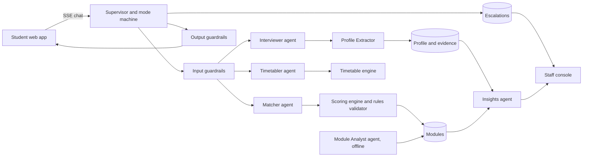

# Architecture

Design rule: **numbers come from code, words come from models.** Scores, clashes, eligibility, pathway progress and counterfactuals are computed by deterministic TypeScript in `api/src/engines`. Agents decide what to ask, call the engines, and explain the results. Scores are therefore stable, testable and defensible.

Every agent also has an offline path: deterministic rules and templates that run when no `ANTHROPIC_API_KEY` is set (or `MODULEMATCH_OFFLINE=1`). The tests and the evaluation harness use it, and the demo cannot fail on network access.

## System overview

## Session modes

The mode machine lives in `api/src/agents/modes.ts`. A transition outside this diagram is refused and traced. The current mode is always shown in the UI as a chip.

## Agents

Agents never compute numbers. The Supervisor calls the engine tools for each agent and passes the results in as data, and each call is written to the trace as a `tool` event. Every agent has a narrow job, and all model output is validated with zod.

| Agent | Inputs | Knowledge | Engine tools | Decisions | Outputs | Model |
|---|---|---|---|---|---|---|
| Supervisor (`agents/supervisor.ts`) | Redacted student turn, session state | Mode machine, intent list | Intent classifier, every agent below | Which agent handles the turn; when to change mode; when to draft an escalation; asks a clarifying question when intent confidence is under 0.6 | SSE events, mode changes, escalation drafts | `MODEL_FAST` for intent, plus rules |
| Interviewer (`agents/interviewer.ts`) | Conversation, profile, unfilled slots, question budget | Quick-mode question plan (8 questions) and follow-ups | None | Which slot to ask about next; when to finish | Streamed question, slider widget, the "Here is what I heard" card | `MODEL_SMART`, streamed |
| Profile Extractor (`agents/extractor.ts`) | One redacted turn, the slots the last question targeted | Slot whitelist, taxonomy, pathway list | None | Which slots the turn fills and with what value | `{ slot, value, quote, confidence }[]`, merged by deterministic rules | `MODEL_FAST`, structured output |
| Module Analyst (`scripts/analyse-modules.ts`, offline) | Public module description | Taxonomy | None | Topic, skill, pathway and demand weights | Derived module fields with a quoted rationale; short descriptions flagged for review | `MODEL_SMART`, batch |
| Matcher (`agents/matcher.ts`) | Recommendation, module record, evidence | Engine output only | `score_modules`, `get_module`, `get_evidence`, `check_rules` | How to explain a score; which eligible alternatives to offer | `Explanation` (every reason cites an evidence ID or module field); the refusal when a student asks to break a rule | `MODEL_SMART` |
| Timetabler (`agents/timetabler.ts`) | Clashes and swaps from the engine | None | `build_timetable`, `find_clashes`, `suggest_swaps` | Wording only; a swap is applied only on confirmation | Clash summary | `MODEL_FAST` |
| Insights (`agents/insights.ts`) | Insight cards from the engine | Cohort statistics | `cohort_stats`, `counterfactuals`, `clash_priorities` | Wording only; a rewrite that changes any number is rejected | Insight cards awaiting a staff decision | `MODEL_SMART` |

## Engines

| Engine | Spec | What it computes |
|---|---|---|
| `scoring.ts` | 8 | Interest, goal, style and breadth sub-scores; fit 0–100; completeness and confidence; eligibility gate |
| `rules.ts` | 9.1 | Prerequisites, programme allowance, ECTS cap, elective ECTS, I-Explore requirement, term balance |
| `timetable.ts` | 9.2 | Overlaps, clash probability with provisional slots, swaps within 10 fit points, staff clash priority |
| `insights.ts` | 9.3 | Interested-but-unconvinced group, counterfactual uplift, overlooked, demand and clash cards, minimum cohort of five |
| `pathways.ts` | 9.4 | Pathway progress and the next-best module |
| `societies.ts` | Could 14 | Top five societies plus one wildcard |

## Guardrail pipeline

| # | Stage | Side | How it works | On trigger |
|---|---|---|---|---|
| G1 | Scope check | Input | Patterns, plus a `MODEL_FAST` classifier outside the interview | Redirect to what the advisor can help with |
| G2 | Sensitive-data redaction | Input | First-person disclosure patterns, plus a `MODEL_FAST` span finder that can only remove text that is really there | Sentence removed before storage; the student is told it was not kept |
| G3 | Injection scan | Input and ingested text | Patterns, plus a `MODEL_FAST` classifier | Instruction stripped and logged; the rest is treated as data |
| G4 | Wellbeing check | Input | Patterns, plus a `MODEL_FAST` classifier | Advising stops, support contacts are shown, and a hand-off is offered with consent |
| G5 | Schema validation | Output | zod | Retry once, then a safe deterministic template |
| G6 | Grounding check | Output | Every cited evidence ID and module field must exist | Unsupported reasons are dropped; blocked if none remain |
| G7 | Rules validation | Output | Rules engine | Ineligible suggestions are removed and escalation is offered |
| G8 | Claims filter | Output | Patterns | Sentences promising grades, jobs or outcomes are removed |

G1–G4 classifier calls run in parallel to keep latency low. Their verdicts are applied in stage order, and every verdict is written to `trace_events`. Model output that passes through G8 is buffered rather than streamed, so the student never sees a removed claim.

**Matching fairness rule.** Matching uses only what the student states as an interest, goal or preference. A stated interest such as "I want to get involved with the Indian community on campus" is kept. A first-person disclosure such as "I am Indian" is removed by G2 and never used.

## Escalation

| Type | Trigger | Queue |
|---|---|---|
| `RULE_EXCEPTION` | Ineligible module or credit-cap request | Senior Tutor |
| `LOW_CONFIDENCE` | Low confidence after the interview, two profile disputes, or a certain clash with no swap | Personal tutor |
| `WELLBEING` | G4, with the student's consent | Student support |
| `COMPLAINT` | Explicit complaint | Admin |

The agent drafts a summary, and the student approves or edits it. The escalation is then created and the mode becomes ESCALATED. Staff respond in the console, the reply appears in the student's chat, and the mode returns to RECOMMEND.

## Data and state

SQLite (better-sqlite3 and Drizzle) holds the sessions, messages, profiles, evidence, modules, slots, shortlist items, escalations, insights, trace events, synthetic cohort and evaluation runs. A session persists its mode, profile, evidence, messages, weights, shortlist, interview state and escalations, so reloading resumes exactly where the student left off.

Contracts are defined once, as zod schemas in `packages/shared/src/schemas.ts`. The API validates every body against them, and the web app imports the same types.
