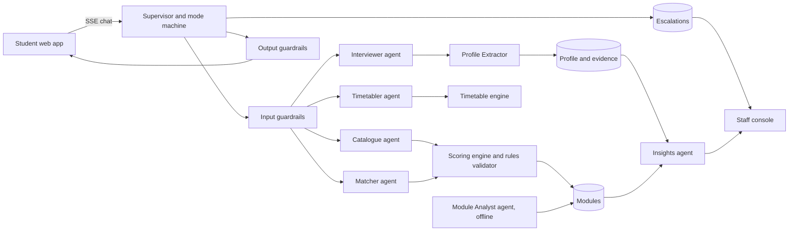
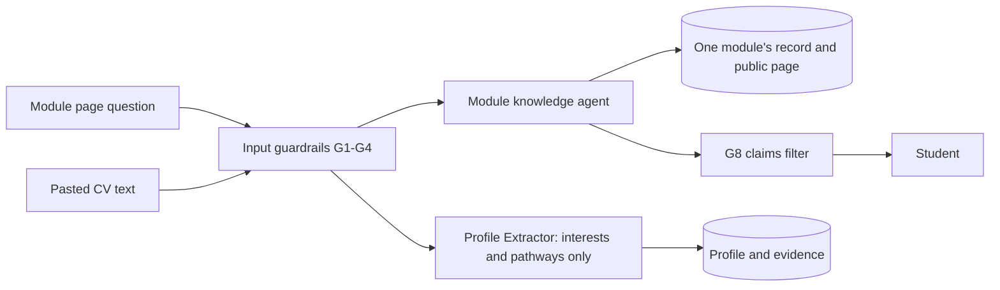
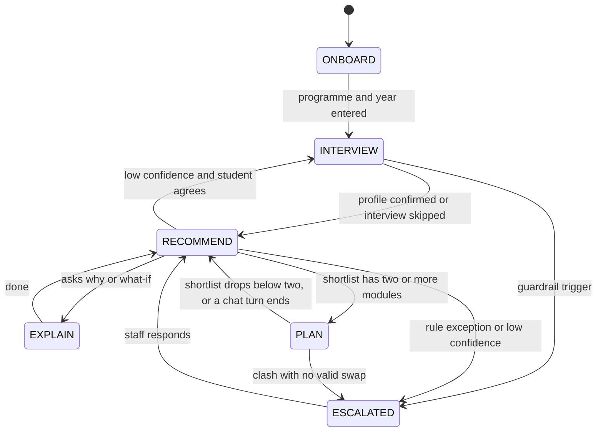

# Architecture

Design rule: **numbers come from code, words come from models.** Scores, clashes, eligibility, pathway progress and counterfactuals are computed by deterministic TypeScript in `server/src/engines`. Agents decide what to ask, call the engines, and explain the results. Scores are therefore stable, testable and defensible.

Every agent also has an offline path: deterministic rules and templates that run when no `ANTHROPIC_API_KEY` is set (or `MODULEMATCH_OFFLINE=1`). The tests and the offline evaluation harness use it, and the demo cannot fail on network access. A live call that fails or returns an incomplete reply falls back to the same path.

The backend is in `server/` (Hono on Node), the web app in `web/` (React, Vite and Tailwind), and the shared zod contracts in `packages/shared`.

## System overview

Two student routes skip the Supervisor but still pass the input guardrails first. The module page's "Ask about this module" chat goes to the module knowledge agent, which reads one module's record. A pasted CV goes to the Profile Extractor:

## Session modes

The mode machine lives in `server/src/agents/modes.ts`. A transition outside this diagram is refused and traced. The current mode is always shown in the UI as a chip.

## Agents

Agents never compute numbers. For most agents the Supervisor calls the engine tools and passes the results in as data. The Catalogue agent is the exception: the model chooses its own tool calls in a loop of at most four rounds, and every tool runs deterministic code. Each tool call is written to the trace as a `tool` event. Every agent has a narrow job, and all model output is validated with zod.

| Agent | Inputs | Knowledge | Engine tools | Decisions | Outputs | Model |
|---|---|---|---|---|---|---|
| Supervisor (`agents/supervisor.ts`, `agents/intent.ts`) | Redacted student turn, session state | Mode machine, the 12 intents of spec 10.1 (including `catalogue_question`) | Intent classifier, every agent below | Which agent handles the turn; when to change mode; when to draft an escalation; asks a clarifying question when intent confidence is under 0.6 | SSE events, mode changes, escalation drafts | `MODEL_LIGHT` for intent, plus rules |
| Interviewer (`agents/interviewer.ts`) | Conversation, profile, unfilled slots, question budget | Quick-mode question plan (8 questions) and follow-ups | None | Which slot to ask about next; when to finish | Streamed question, slider widget, the "Here is what I heard" card | `MODEL_SMART`, streamed |
| Profile Extractor (`agents/extractor.ts`) | One redacted turn and the slots the last question targeted, or redacted CV text | Slot whitelist, taxonomy, pathway list | None | Which slots the turn fills and with what value; from a CV, interest and pathway slots only | `{ slot, value, quote, confidence }[]`, merged by deterministic rules | `MODEL_FAST`, structured output |
| Module Analyst (`scripts/analyse-modules.ts`, offline) | Public module description | Taxonomy | None | Topic, skill, pathway and demand weights | Derived module fields with a quoted rationale; short descriptions flagged for review | `MODEL_SMART`, batch |
| Matcher (`agents/matcher.ts`) | Recommendation, module record, evidence | Engine output only | `score_modules`, `get_module`, `get_evidence`, `check_rules` | How to explain a score; which eligible alternatives to offer | `Explanation` (every reason cites an evidence ID or module field); the refusal when a student asks to break a rule | `MODEL_SMART` |
| Timetabler (`agents/timetabler.ts`) | Clashes and swaps from the engine | None | `build_timetable`, `find_clashes`, `suggest_swaps` | Wording only; a swap is applied only on confirmation | Clash summary | `MODEL_LIGHT` |
| Catalogue (`agents/catalogue.ts`) | Redacted question, modules it names, the student's ranking | Catalogue records, published assessment, taxonomy | `search_modules`, `get_module`, `compare_modules` (tool loop, at most four rounds) | Which searches to run; which modules answer the question | Plain-text answer under 120 words citing module codes, ineligible modules marked. A reply naming a module code that is not in the catalogue is blocked and replaced by the search results; G8 runs on the buffered reply. Offline, the search results as a list | `MODEL_SMART`, low effort |
| Module knowledge (`agents/knowledge.ts`) | One module's record and public page (G3-scanned), the student's fit for it, a redacted question | Description, learning outcomes, published assessment, prerequisites, resources, source URL | None (the facts are passed in as data) | Whether the record answers the question; if not, say so and point to the module page | Two-sentence AI summary with highlight chips (cached per module), and answers under 90 words, buffered so G8 runs first. Offline, rule-based answers from the same facts | `MODEL_SMART`, low effort |
| Insights (`agents/insights.ts`) | Insight cards from the engine | Cohort statistics | `cohort_stats`, `counterfactuals`, `clash_priorities` | Wording only; a rewrite that changes any number is rejected | Insight cards awaiting a staff decision | `MODEL_SMART` |

The "How it works" page shows the same nine agents as cards, grouped as student-facing (Supervisor, Interviewer, Profile Extractor, Matcher, Timetabler, Catalogue, module knowledge), staff-facing (Insights) and offline (Module Analyst), each with its model tier, tools and the one thing it never does. The cards come from `web/src/trace/agents.ts`, and a web test checks each tier against the agent's source. A card lights up when the session's trace has an event from that agent (actors `catalogue` and `knowledge` included). The flowchart draws the Catalogue agent's tool loop and the staff path from the Insights engine through the Insights agent to the staff console.

## Engines

| Engine | Spec | What it computes |
|---|---|---|
| `scoring.ts` | 8 | Interest, goal, style and breadth sub-scores; fit 0–100; completeness and confidence; eligibility gate |
| `rules.ts` | 9.1 | Prerequisites, programme allowance, ECTS cap, elective ECTS, I-Explore requirement, term balance |
| `timetable.ts` | 9.2 | Overlaps, clash probability with provisional slots, swaps within 10 fit points, staff clash priority |
| `insights.ts` | 9.3 | Interested-but-unconvinced group, counterfactual uplift, overlooked, demand and clash cards, minimum cohort of five |
| `pathways.ts` | 9.4 | Pathway progress and the next-best module |
| `societies.ts` | Could 14 | Top five societies plus one wildcard |
| `feedback.ts` | 13 | Staff feedback totals, recent down-votes and the JSONL export |

## Guardrail pipeline

| # | Stage | Side | How it works | On trigger |
|---|---|---|---|---|
| G1 | Scope check | Input | Patterns, plus a `MODEL_FAST` classifier outside the interview | Redirect to what the advisor can help with |
| G2 | Sensitive-data redaction | Input | First-person disclosure patterns, plus a `MODEL_FAST` span finder that can only remove text that is really there | Sentence removed before storage; the student is told it was not kept |
| G3 | Injection scan | Input and ingested text | Patterns, plus a `MODEL_FAST` classifier | Instruction stripped and logged; the rest is treated as data |
| G4 | Wellbeing check | Input | Patterns, plus a `MODEL_FAST` classifier | Advising stops, support contacts are shown, and a hand-off is offered with consent |
| G5 | Schema validation | Output | zod | Retry once, then a safe deterministic template |
| G6 | Grounding check | Output | Every cited evidence ID and module field must exist | Unsupported reasons are dropped; blocked if none remain |
| G7 | Rules validation | Output | Rules engine | Ineligible suggestions are removed and escalation is offered |
| G8 | Claims filter | Output | Patterns | Sentences promising grades, jobs or outcomes are removed |

G1–G4 classifier calls run in parallel to keep latency low. Their verdicts are applied in stage order, and every verdict is written to `trace_events`. Model output that passes through G8 is buffered rather than streamed, so the student never sees a removed claim.

**Matching fairness rule.** Matching uses only what the student states as an interest, goal or preference. A stated interest such as "I want to get involved with the Indian community on campus" is kept. A first-person disclosure such as "I am Indian" is removed by G2 and never used.

## Escalation

| Type | Trigger | Queue |
|---|---|---|
| `RULE_EXCEPTION` | Ineligible module or credit-cap request | Senior Tutor |
| `LOW_CONFIDENCE` | Low confidence after the interview, two profile disputes, or a certain clash with no swap | Personal tutor |
| `WELLBEING` | G4, with the student's consent | Student support |
| `COMPLAINT` | Explicit complaint | Admin |

The agent drafts a summary, and the student approves or edits it. The escalation is then created and the mode becomes ESCALATED. Staff respond in the console, the reply appears in the student's chat, and the mode returns to RECOMMEND.

## Data and state

SQLite (better-sqlite3 and Drizzle) holds the sessions, messages, profiles, evidence, modules, slots, shortlist items, escalations, insights, trace events, synthetic cohort and evaluation runs. A session persists its mode, profile, evidence, messages, weights, shortlist, interview state and escalations, so reloading resumes exactly where the student left off.

Contracts are defined once, as zod schemas in `packages/shared/src/schemas.ts`. The API validates every body against them, and the web app imports the same types.

## Answer feedback

Students can rate any AI answer with a thumbs up or down: advisor chat replies (target `message`, the stored message id from `done.messageId`), module Q&A answers (`module-answer`, the streamed `done.messageId` plus the module id), explanations and AI summaries (`explanation` and `summary`, keyed by module). A down-vote can carry a reason (`wrong`, `unhelpful`, `unclear`, `unsafe`, `other`) and a comment of up to 500 characters.

The client sends the question and an excerpt of the answer (at most 600 characters) with the vote, so a down-vote can be reviewed later. The comment and both texts pass G2 redaction (pattern pass, then the live model pass) and G3 injection stripping before they are stored in the `feedback` table, so raw sensitive text is never kept. Each vote writes one trace event (actor `student`, kind `agent`) with a summary only. One vote counts per answer: voting again replaces the earlier vote. Deleting the profile deletes the session's feedback with everything else (spec 20.3).

Staff see totals, up and down by answer type, and recent down-votes at `/staff/feedback` (`GET /api/staff/feedback`). Items carry no student or session id. `GET /api/staff/feedback/export` returns JSONL rows `{ question, answer, rating, reason, comment, kind, moduleId }` as a seed set for prompt evaluation or later fine-tuning. The export contains only redacted text, and in this prototype every session is synthetic.

## CV input

`POST /api/sessions/:id/cv` takes pasted CV or personal-statement text (up to 20,000 characters). The text runs through the input guardrails first: G2 removes grades and personal disclosures, and G3 strips instructions. If G4 flags a wellbeing concern, nothing is extracted and a support hand-off is offered, as in the chat. The Profile Extractor then reads the redacted text for interest and pathway slots only. A CV shows what a student has done, not how they like to learn, so it never overwrites a stated learning-style preference. The CV itself is never stored. Only evidence quotes of at most 200 characters from the redacted text are kept, and each one links back to its profile item like any other evidence.

## Evaluation

| Harness | Command | Models | What it checks | Results |
|---|---|---|---|---|
| Offline | `npm run eval` (`scripts/run-evals.ts`) | None | Ranking quality (12 personas), extraction (4 scripted interviews, 33 slots), 15 adversarial guardrail inputs, determinism, the privacy threshold | `data/eval-latest.json`, stored in `eval_runs` and shown on the "How it works" page |
| Live | `npm run eval:live` (`scripts/run-live-evals.ts`) | `MODEL_SMART` and `MODEL_FAST`, with `MODEL_JUDGE` (Fable 5.1) as judge | Module facts from published data, declining questions the data cannot answer, live extraction, 7 subtle guardrail cases, grounded explanations | `data/eval-live-latest.json` |

The cases live in `scripts/eval-cases.ts`. A live answer that silently fell back to a template never counts as a live pass, and a live run that misses any target exits non-zero. The README lists the latest numbers.

## Deployment

https://modulematch.vercel.app is built by Vercel's GitHub integration on every push to `main`, with a preview for each pull request. `scripts/build-vercel.ts` writes a Build Output API bundle: the web app as static files, and the Hono API (`server/src/vercel.ts`) as one Node function. Each function instance seeds SQLite into its own `/tmp` from `data/` on a cold start, so a session lasts only while the instance is warm. Live models switch on when `ANTHROPIC_API_KEY` is set in the Vercel project; without it the site runs in offline mode.
