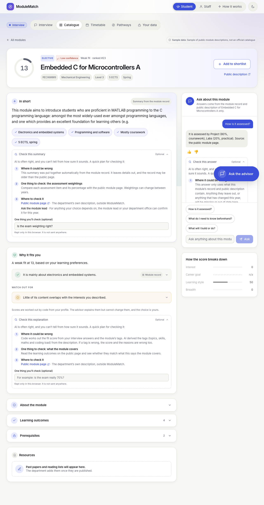
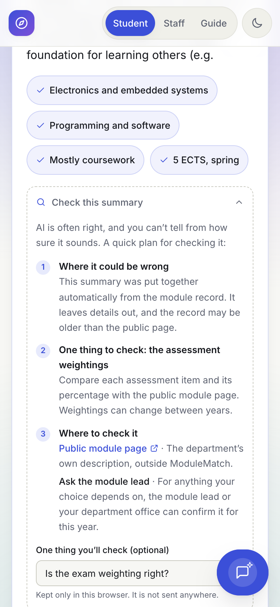

# AI Claim Checker in ModuleMatch

ModuleMatch uses AI to write three things on the module page: the "In short" summary, the "Why it fits you"
explanation, and the answers in "Ask about this module". Each one now has an optional **Check this…**
disclosure underneath. It gives the student a short plan for checking that piece of content themselves.

## The skill

[AI Claim Checker](https://github.com/GarethManning/education-agent-skills/tree/main/skills/student-learning/ai-claim-checker)
by Gareth Manning is a student-facing skill (Domain 20, `student-learning/ai-claim-checker`, evidence strength
"moderate"). After an AI explanation, it asks the learner for three things:

1. **One place it could be wrong:** a specific claim that could be inaccurate, oversimplified or context-dependent.
   Justified agreement is accepted, and the learner should not invent a flaw.
2. **One thing to check:** a concrete way to verify that claim.
3. **One source to consult:** an independent, appropriate source, so not another AI and not a general web search.

The skill treats this as a checking plan, not proof that anything was verified. It aims to build epistemic
vigilance: the habit of treating AI output as a claim to evaluate rather than a fact to absorb.

The full skill is vendored, unchanged, at
[`.claude/skills/ai-claim-checker/SKILL.md`](../../.claude/skills/ai-claim-checker/SKILL.md).

## Evidence base

These are the sources listed in the skill's frontmatter:

- Long, D. & Magerko, B. (2020). *What is AI literacy? Competencies and design considerations.* Critical appraisal
  of AI outputs is one of the core competencies.
- Efimova & Nygren (2026). *Epistemic vigilance in the age of generative AI.* Students who rely mainly on AI sources
  cross-check claims less often.
- UNESCO / Miao, F. & Cukurova, M. (2024). *AI Competency Framework for Students.* It lists "evaluate AI outputs
  critically" as a student competency.
- Roe et al. (2024). *Critical AI literacy framework for secondary education.* It teaches source triangulation:
  "what would confirm or disconfirm this?"
- Wineburg, S. et al. (2022). *Lateral reading: reading less and learning more.* Fact-checkers leave a source to see
  what other sources say about it, and students can be trained to do the same.

The skill lists its own limits. The check needs some subject knowledge to work well, and it builds a habit
rather than guaranteeing a correct judgement.

## How it maps onto ModuleMatch

The component is `web/src/student/claimcheck/ClaimCheck.tsx` and its rules are in
`web/src/student/claimcheck/claimCheck.ts`. Both are deterministic and offline. They apply plain rules to text
already on the page, so there are no model calls and no new server routes.

| Skill step | "In short" summary | "Why it fits you" | "Ask about this module" answer |
| --- | --- | --- | --- |
| Where it could be wrong | AI wrote it from the public description, so shortening may drop details or overstate them. A template summary is labelled as built from the module record, which may be out of date. | Code calculates the score, but from tags an AI derived from the description. If the tags were edited by staff, the text says they were reviewed. | It only uses what this module's record and description contain. Anything missing or changed this year will not be in it. |
| One thing to check | Picked from what the text mentions, in priority order: assessment weightings, prerequisites, capacity, when it runs, credits and workload, what it covers. If none of these come up, there is a fallback for each content type. | Same rules | Same rules |
| Source | Public module page (`Module.sourceUrl`) | Public module page | Public module page, plus "Ask the module lead" |

"Ask the module lead" is added for answers and whenever the thing to check is something a person should confirm
for this year: assessment, prerequisites or capacity.

The skill's learner-attempt step becomes an optional field: "One thing you'll check". The note stays in the
student's browser. Summary and explanation notes are kept in `localStorage` for each module, and chat notes last
only for that conversation. Nothing is sent to the server.

## Why it is optional, not a gate

The skill's own prompt makes the check a gate ("Before we use this explanation…"). ModuleMatch keeps the three
steps but drops the gate, for these reasons:

- **It is a decision aid, not a lesson.** Students come to compare modules. Hiding the summary or the fit
  explanation behind a task would get in the way of what the page is for. Students would also learn to click
  through it, and the skill warns against exactly that ("satisfy the check mechanically").
- **There is no coach to read the answer.** The skill expects an AI coach to evaluate the learner's response and
  push back on a weak verification such as "Google it". ModuleMatch adds no model calls, so a required answer would
  never be read or followed up. A prompt that is always available, specific to the content and points to a real
  source is the honest version.
- **It keeps a human in the loop without blocking.** The plan always points outside ModuleMatch: to the
  department's public page and, where it matters, to the module lead. The existing guardrails (scores calculated by
  code, sourced reasons, refusals to give guarantees) still apply. The claim check adds a visible, low-cost step
  towards independent verification.
- **The skill accepts justified agreement.** The skill says the learner should not be forced to find a flaw. A
  closed-by-default disclosure respects that: a student who trusts a summary does not need to open it.

## Licence and attribution

- **Skill:** "AI Claim Checker" by Gareth Manning, Copyright (c) 2026 Gareth Manning, from
  [GarethManning/education-agent-skills](https://github.com/GarethManning/education-agent-skills), licensed under
  [CC BY-SA 4.0](https://creativecommons.org/licenses/by-sa/4.0/).
- **Changes:** `SKILL.md` is copied verbatim. A `NOTICE.md` with this attribution sits next to it.
- **Scope:** the vendored skill file, and any adaptation of it, stays under CC BY-SA 4.0. ModuleMatch's code that
  implements the idea (`web/src/student/claimcheck/` and where it is placed on the module page) was written
  separately and is the project's own. The UI text in this code is new writing, not copied from the skill. The
  author does not endorse ModuleMatch.
