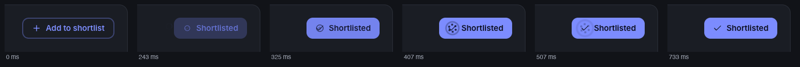
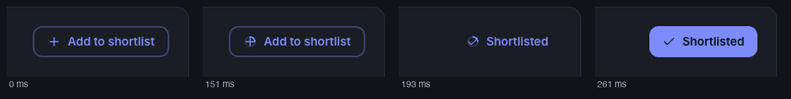
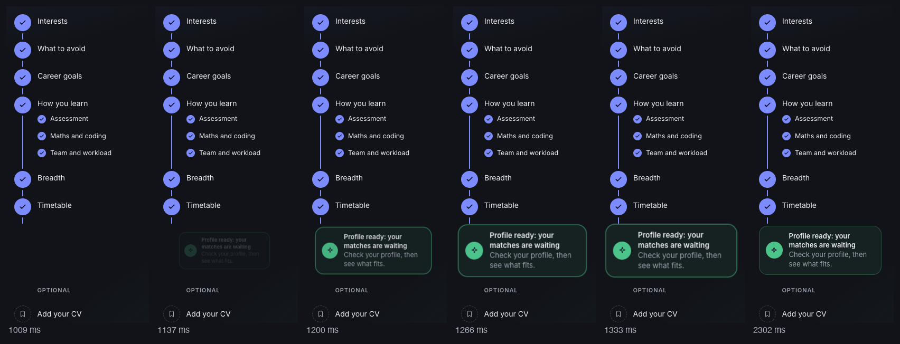
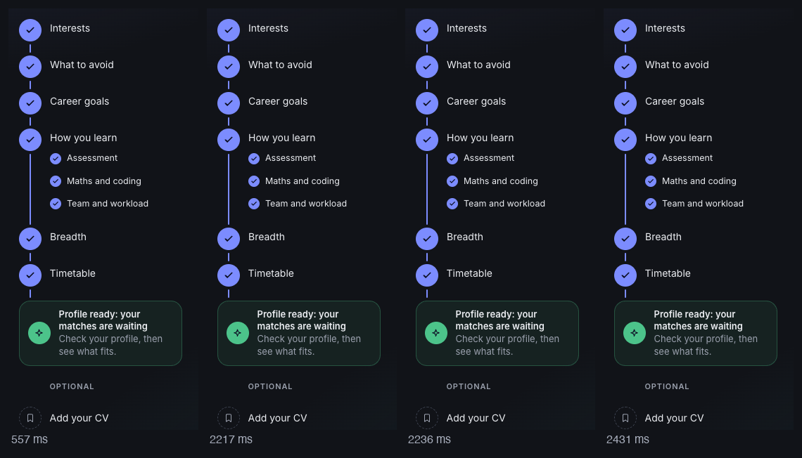
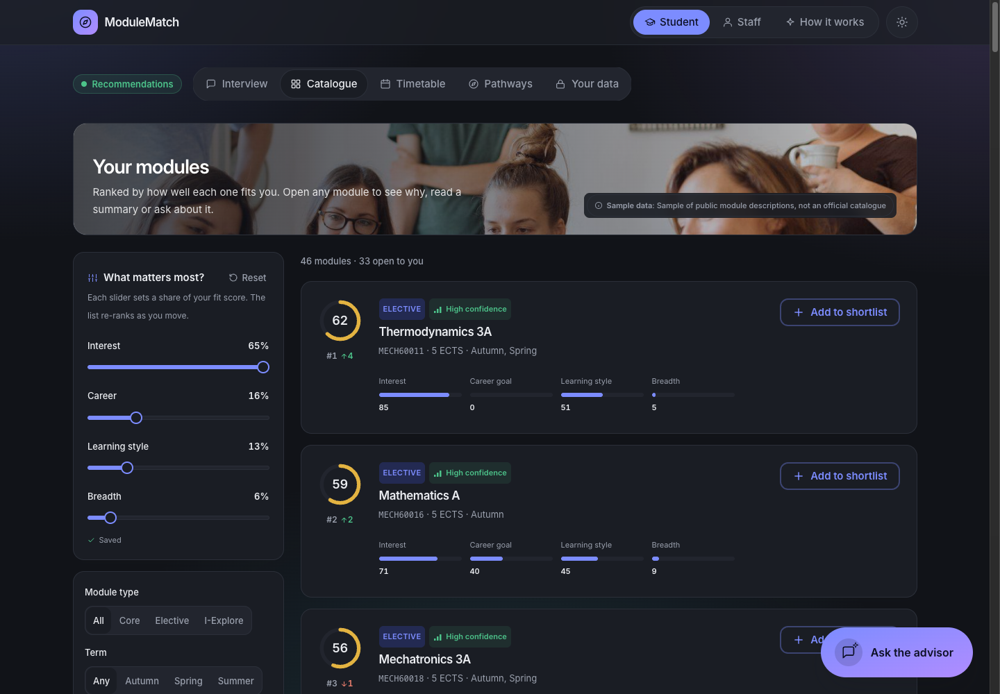

# Education & Learning animation skill

ModuleMatch's student screens use the **Education & Learning** animation skill from
[dylantarre/animation-principles](https://github.com/dylantarre/animation-principles)
(`skills/08-by-industry/education-learning`). It applies Disney's 12 principles to learning products, and
its key principle fits a module advisor well: *celebrate progress generously, handle mistakes gently*.

- Vendored copy: `.claude/skills/education-learning-animation/SKILL.md`, so Claude Code picks it up in this repo.
- Licence: MIT, Copyright (c) 2024 Dylan Tarre. The full text is in `.claude/skills/education-learning-animation/LICENSE`.
- Background reading: the same repo's `skills/03-by-role-persona/educator-teacher` skill, whose rules
  ("one concept per scene", "avoid decorative animation that doesn't teach", reduced-motion alternatives)
  shaped what we left out.

## Motion tokens

`web/src/motion/tokens.ts` encodes the skill's timing table as named presets, and every animation in this
change goes through `useMotionTokens()`.

| Preset | Duration | Easing | Used for |
| --- | --- | --- | --- |
| `answerFeedback` | 200ms | ease-out | a step ticks, a module leaves the shortlist, a message or error appears |
| `correctCelebration` | 600ms | spring | a module joins the shortlist |
| `lessonTransition` | 350ms | ease-in-out | content arrives: timeline rows, module cards, the first score sweep, CV panel swaps |
| `progressUpdate` | 300ms | ease-out | a fit score, rank change, connector or progress bar moves |
| `achievementUnlock` | 800ms | custom bounce (0.7, 1.08, 0.97, 1) | the profile is complete |
| `settle` | 300ms | spring | follow-through for numbers after a progress update |

`useMotionTokens()` reads `prefers-reduced-motion`. Under reduced motion `transition()` returns an instant
change and `softEnter()` returns an opacity-only fade, the shortlist burst and the achievement bounce are
skipped, and the tick is drawn at once.

## Where each principle appears

| Principle | Where in the app | Timing |
| --- | --- | --- |
| 1. Squash and stretch | The shortlist button presses down slightly while tapped (`ShortlistButton`; existing, now on the feedback clock). | 200ms ease-out |
| 2. Anticipation | The shortlist icon turns into a spinner while the request is in flight (existing), so the student sees something is about to happen before the check lands. | 200ms ease-out |
| 3. Staging | One focal thing at a time: the profile-ready card waits for the last tick and the chat's summary card (1s) before it bounces; rank arrows only animate when they change, not on the card entrance; the burst is confined to the button that was pressed. | delays from the tokens |
| 4. Pose to pose | The interview timeline moves between defined states (upcoming, current, done), each with its own pose. | 200ms ease-out |
| 5. Follow-through and overlapping action | The shortlist check lands with a spring overshoot, then the burst follows 120ms later. A changed fit score's number rides up or down with the change and springs back into place. | 600ms spring; 300ms ease-out then a 300ms spring settle |
| 6. Slow in and slow out | All presets ease; timeline rows, module cards and the CV panel arrive on the 350ms ease-in-out clock. | 350ms ease-in-out |
| 7. Arc | The burst's six sparks curve out along arcs rather than straight lines. | 600ms ease-out |
| 8. Secondary action | The burst ring and sparks behind the shortlist check; the soft halo that opens around the profile-ready card. | 600ms; 480ms |
| 9. Timing | The skill's table, as tokens: feedback 200ms, celebration 600ms, transitions 350ms, progress 300ms, achievement 800ms. | as listed |
| 10. Exaggeration | Success is celebrated (burst, bounce); errors are not. The CV error, the societies error and empty state, and the "Not saved" weights message fade and rise 4px, with no shake or flash. | 200ms ease-out |
| 12. Appeal | The warm unlock message, "Profile ready: your matches are waiting", in the timeline (and under the phone progress bar). | 800ms bounce |

Solid drawing (principle 11) is about illustration style, which this change does not touch.

## Screenshots

Captured in headless Chrome over CDP against a live session (frame times are from the click or the
submitted answer).

Adding a module to the shortlist: spinner, the check lands, the burst follows through, then settles.

The same with `prefers-reduced-motion: reduce`: the state changes with no burst.

Answering the last interview question: the step ticks, then the profile-ready card bounces in once the
chat summary has drawn.

Reduced motion: the card is simply there, with an opacity fade.

The catalogue after a weight change, with the re-ranked scores settled and rank arrows shown.

## What we deliberately left out

- **Streaks, XP, levels and points counters.** The skill suggests them for learning apps, but a module
  advisor is used a few times a year and should not push students to come back for the sake of it, or make
  a module choice feel like a game score.
- **Confetti and full-screen celebrations.** Shortlisting a module is a small decision; the burst stays
  inside the button.
- **Mascots and squash-and-stretch characters.** The interviewer portrait already nods while speaking, so
  adding more character motion would compete with it.
- **Anything for wrong answers.** There are no wrong answers in the interview, so there is no error
  shake, red flash or "try again" animation. Errors only fade in.
- **Animated focus or blocking overlays.** No animation moves focus, delays a click or hides content; the
  burst and halo have `pointer-events: none` and are hidden from assistive technology, and the unlock
  message is announced through a polite live region.
