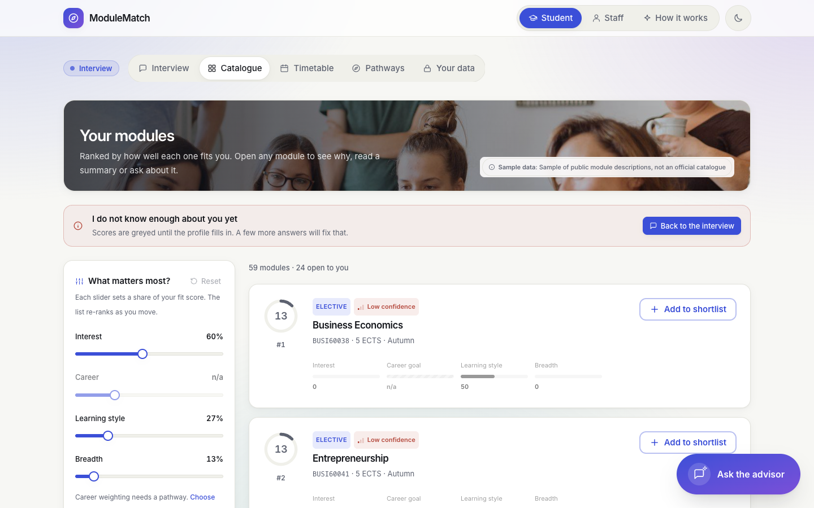
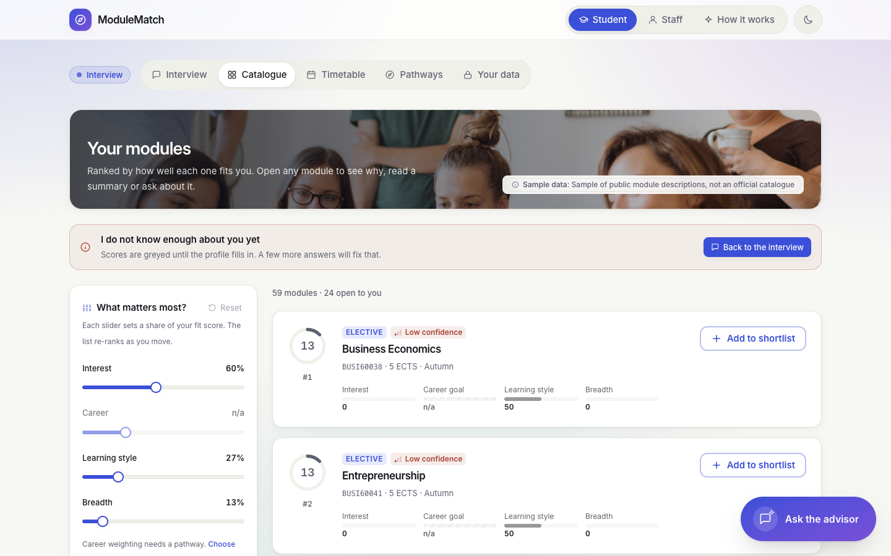
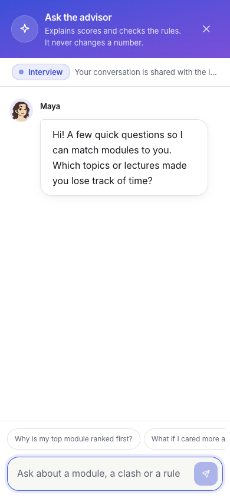
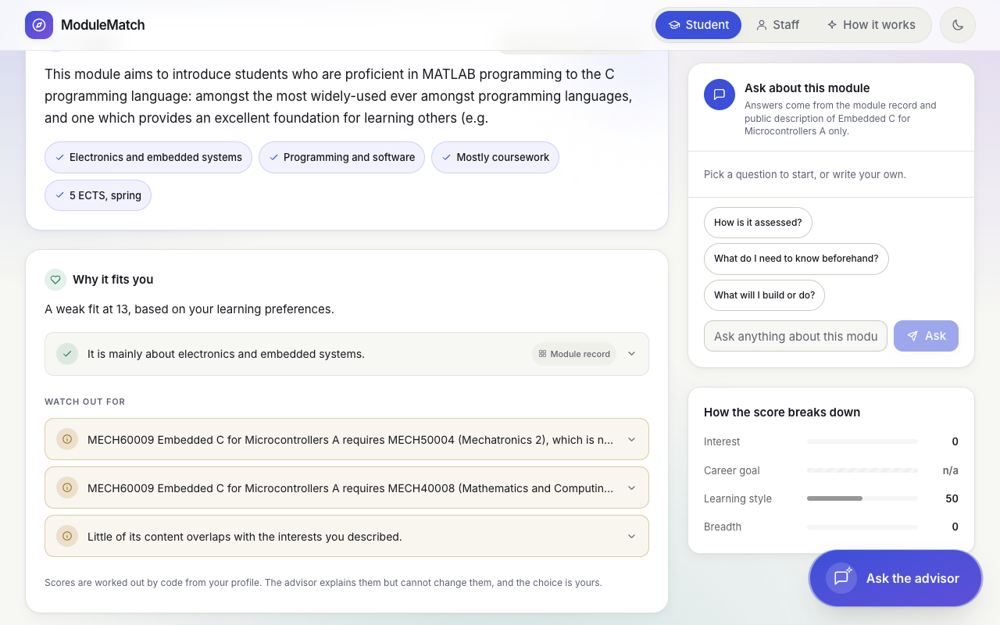
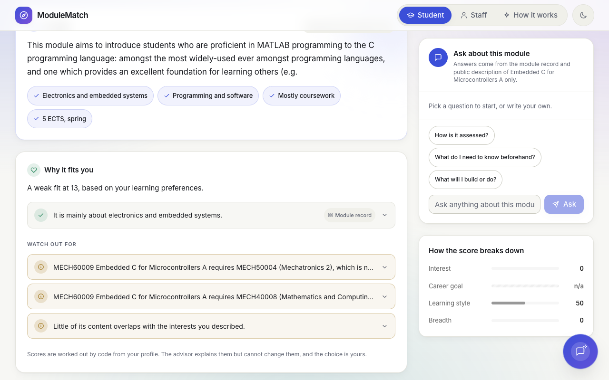

# UI/UX Pro Max audit

## The skill

[UI/UX Pro Max](https://github.com/nextlevelbuilder/ui-ux-pro-max-skill) is an agent skill for UI and UX work. It has a
priority-ordered rule table (accessibility first, then touch targets, performance, style, layout, typography and
colour, animation, forms) and a local search tool over CSV data: 120 UX guidelines, colour palettes, font pairings,
styles and stack notes. It is MIT licensed, Copyright (c) 2024 Next Level Builder.

A trimmed copy is vendored at `.claude/skills/ui-ux-pro-max/` with its `LICENSE`, so anyone on the team can use it:
`SKILL.md`, `references/`, the four runtime scripts and the data they load. We left out the upstream tests, the
icon and font licence dumps (not read at runtime) and every stack file except `react` and `html-tailwind`. Two local
changes: `SKILL.md` points at this repository's path instead of the plugin root variable, and the design-system
output labels any section that fell back to general defaults (`UNMATCHED ...`), so a default is never read as a
verified pick. Run it from the repository root with:

```bash
python3 .claude/skills/ui-ux-pro-max/scripts/search.py "focus states keyboard" --domain ux
```

## What the tool recommended, and what we kept

`search.py "education student course advisor" --design-system` returned:

| Part | Recommendation |
|---|---|
| Pattern | Feature-Rich Showcase: hero, 4 to 6 feature cards, social proof, repeated CTA |
| Style | Claymorphism: "soft 3D, chunky, playful, toy-like, bubbly, thick borders (3-4px), double shadows" |
| Colours | Indigo primary `#4F46E5`, orange CTA `#EA580C`, background `#EEF2FF`, foreground `#1E1B4B` |
| Typography | Baloo 2 headings, Comic Neue body. Mood: "kids, education, playful". Best for: "Children's apps, educational games" |
| Anti-patterns | Dark modes, complex jargon |
| Checklist | 4.5:1 text contrast, visible focus, `prefers-reduced-motion`, no emoji icons, check 375 to 1440 px |

We did **not** adopt the claymorphism style or the Comic Neue and Baloo 2 fonts. The tool matched on "education",
and its own result says those picks are for children's apps and educational games. ModuleMatch serves university
students choosing degree modules and the staff who run them. They are adults making a decision that affects their
degree, so the interface should read as a calm, trustworthy tool, not a toy. The "avoid dark modes" advice also
does not fit: the app already ships a dark theme that students use. A narrower search,
`"professional academic readable" --domain typography`, gave Crimson Pro with Atkinson Hyperlegible ("Universities,
research papers"), which is a much better fit, but swapping fonts would be a restyle, so we kept Inter.

We kept the parts that apply to any product: the accessibility, touch, typography, colour, motion and forms rules,
plus the pre-delivery checklist.

## How we measured

We ran headless Chrome over the DevTools protocol against the dev build at 1440 px and 390 px, in light and dark
themes, on 12 screens: landing, welcome, start, interview, catalogue, timetable, pathways, the advisor chat and four
staff pages. On each screen a script listed:

- interactive elements smaller than 24 x 24 CSS px (WCAG 2.2 target size) and buttons under 44 px;
- text under 12 px;
- text below 4.5:1 contrast (3:1 for large text), measured against the composited background and including
  ancestor opacity;
- buttons and fields with no accessible name.

We checked each hit by hand. Text that was mid-animation (opacity 0 while scrolling into view), text on photos or
gradients, and card links that stretch to the whole card were false positives. Icon buttons are named by the `Icon`
component's `aria-label` on the SVG, so they were not real failures either.

Skill guidance cited for each rule (all from `--domain ux` unless stated):

- "Color Contrast: Minimum 4.5:1 ratio for normal text" (High)
- "Target Size (Minimum): WCAG 2.2 AA requires 24 CSS px pointer targets"; "Touch Target Size: 44pt on iOS ... for
  web use the separate WCAG Target Size rule" (High)
- "Focus States: Use a visible focus ring on every interactive control, including modal controls" (High)
- "ARIA Labels: Add aria-label for icon-only buttons" (High)
- "Line Height: Use 1.5-1.75 for body text" (Medium); rule 6 "Text < 12px body" is an anti-pattern
- "Reduced Motion: Check prefers-reduced-motion media query" (High)
- "Input Labels: Every input needs a visible label"; "Error Placement: Show a specific error below the input and
  reference it with aria-describedby" (High)

## Findings

| # | Rule | Evidence | Fix |
|---|---|---|---|
| 1 | 1 Accessibility: contrast | `fit-mid` text measured 3.00:1 on white ("near cap" in the staff module picker). The staff "New" escalation badge, white on `fit-mid`, was also 3.00:1 | `--color-fit-mid` light value `#c48a12` to `#7d5500`: 6.62:1 on surface, 4.97:1 on its own 15% tint over canvas |
| 2 | 1 Accessibility: contrast | `fit-high` text measured 4.04:1 on canvas (landing fit score "92"). It is used as text on about 20 screens | `--color-fit-high` light value `#1f8a5b` to `#156e48`: 6.26:1 on surface, 4.70:1 on its own 15% tint over canvas |
| 3 | 1 Accessibility: contrast | `clash-likely` is used as text in staff insight cards and escalation badges: 2.99:1 on white (computed from the token) | `--color-clash-likely` light value `#e07b1a` to `#964c0e`: 6.29:1 on surface, 4.72:1 on its own 15% tint over canvas |
| 3b | 1 Accessibility: contrast | Status badges put the colour as text on its own 10 to 15% tint (`text-fit-low bg-fit-low/10`, `ConfidenceBadge`, clash badges). Computed for the old values: `fit-low` 4.05:1 and `clash-certain` 4.07:1 on a 15% tint over canvas | `--color-fit-low` `#b4483c` to `#a8402f` and `--color-clash-certain` `#c0392b` to `#b0352a`. All five status colours now clear 4.5:1 on their 10 and 15% tints over surface and canvas. The dark-theme values already passed and are unchanged |
| 4 | 1 Accessibility: contrast | Sub-score labels on not-yet-eligible module cards were 2.51:1 to 2.59:1 (light) and 3.18:1 (dark), because `opacity-60` dimmed the whole list | `SubScoreBars` now dims only the bars; the labels keep full contrast |
| 5 | 6 Typography | 24 places in shared components, staff pages, chat and the shell set `text-[11px]` (chips, badges, sample-data label, slider hints, histogram axes, chat headings) | New `--text-2xs` token (12px, 16px line height) in `index.css`; those 24 places use `text-2xs` |
| 6 | 2 Touch | Advisor send button and close button were 40 x 40 px. They are the main controls in the chat on a phone | Both now `size-11` (44 x 44 px) |
| 7 | 2 Touch | Staff "Show as table" disclosure was 20 px tall, under the 24 px minimum | `py-1` gives 28 px |
| 8 | 2 Touch, 5 Layout | The "Ask the advisor" launcher is a fixed 219 x 72 px pill. With the page at the top it sat over the module page's question chips at 1280 and 1440 px and over a shortlist button on the catalogue (measured with a hit test against every control under it) | The launcher drops to its 72 x 72 px round icon once the page scrolls past 80 px, or whenever the full pill would cover a control. It keeps its `aria-label`. After the fix nothing sits under the full pill at 1280, 1440 or 390 px. The page already reserves 112 px of bottom padding (launcher 72 px plus 24 px inset plus 16 px gap), so at the bottom of every page no control is under the launcher |
| 9 | 1 Accessibility: names | The audit found 6 icon buttons with no text | Already compliant: each has an accessible name from the SVG `aria-label` |
| 10 | 1 Accessibility: focus and keyboard | Global `:focus-visible` outline in brand colour; skip link to `#main`; dialogs use native `<dialog>` | Already compliant |
| 11 | 6 Typography: body | Body is 16px with 1.65 line height (`--text-base`) | Already compliant |
| 12 | 6 Colour tokens | No raw hex in components. The staff header uses `slate-950` and `white` over a photo | Already compliant (no hex); left as is to avoid restyling |
| 13 | 7 Animation | Shared `--ease-out-soft` and `--animate-*` tokens; a global `prefers-reduced-motion` block cuts animations and transitions to 1 ms; `MotionConfig reducedMotion="user"` turns off Motion transforms | Already compliant |
| 14 | 8 Forms | Start form fields have visible labels. The chat box has a screen-reader label and placeholder text, which is the usual pattern for a chat composer | Already compliant |
| 15 | 2 Touch | The theme toggle is 40 px on phones (44 px from `sm`) | Kept: it passes the 24 px WCAG 2.2 minimum and is not a primary control, and the header has no room on a 390 px screen |
| 16 | Out of scope | Text under 12px remains in the interview screen, the catalogue card "Not eligible yet" chip, the pathways bubble cloud and the catalogue "only open to me" checkbox (16 px) | Not touched here: other PRs are editing those folders |

The round 72 px icon can still pass over a control while the student scrolls (for example a catalogue card's
shortlist button at 1280 px), as any floating button does. That control scrolls clear of it, and none is ever stuck
under the launcher at the end of the page.

Disabled controls (the weights "Reset" button and the career slider before a pathway is chosen) measured 2.16:1 and
3.95:1. WCAG does not require contrast for inactive controls, so we left them alone.

### Counts across all 24 screen and width combinations (light theme)

| Check | Before | After |
|---|---|---|
| Text under 4.5:1 (true positives only) | 50 | 12, all disabled controls |
| Text under 12px | 108 | 58, all in folders out of scope for this PR |
| Targets under 24px (true positives) | 6 | 4, the catalogue checkbox, out of scope |

## Before and after

Catalogue at 1440 px. Chips and sub-score labels go from 11px to 12px, and the labels on greyed-out cards are no
longer dimmed:

| Before | After |
|---|---|
|  |  |

Advisor at 390 px. The send and close buttons go from 40 px to 44 px:

| Before | After |
|---|---|
|  |  |

Module page at 1280 px, part-way down. Before, the labelled pill sits over the right-hand column; after, it is the
round icon:

| Before | After |
|---|---|
|  |  |
